<!--
  ✿ Pastel Tech profile — Sara Zambrano
  Every image in /assets is generated by scripts/build_assets.py (light + dark versions).
  Stats are refreshed daily by the workflow in .github/workflows.
  See MAINTENANCE.md for how to update anything.
-->

<picture>
  <source media="(prefers-color-scheme: dark)" srcset="https://raw.githubusercontent.com/sofiaas16/sofiaas16/main/assets/hero-dark.svg">
  
</picture>

<a href="#about">about</a> &nbsp;✦&nbsp;
<a href="#stack">stack</a> &nbsp;✦&nbsp;
<a href="#projects">projects</a> &nbsp;✦&nbsp;
<a href="#activity">activity</a> &nbsp;✦&nbsp;
<a href="#play">play</a> &nbsp;✦&nbsp;
<a href="#connect">connect</a>

 

<picture>
  <source media="(prefers-color-scheme: dark)" srcset="https://raw.githubusercontent.com/sofiaas16/sofiaas16/main/assets/section-about-dark.svg">
  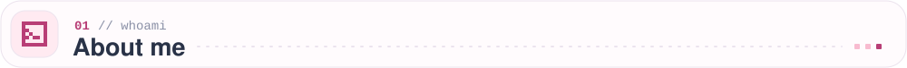
</picture>

I'm a software developer who enjoys building web applications end-to-end — from responsive, carefully designed interfaces to the backend logic and databases that power them. I learn fast, adapt easily and love solving problems as part of a team, always aiming for solutions that are **functional, visually consistent and easy to maintain**.

<picture>
  <source media="(prefers-color-scheme: dark)" srcset="https://raw.githubusercontent.com/sofiaas16/sofiaas16/main/assets/about-dark.svg">
  
</picture>

<b>🌷 Beyond the code</b> (click to open)

 

> *“Technology connects creativity and purpose — and I love being part of that bridge.”*

📚 reading & continuous learning &nbsp;·&nbsp; 🎧 music as inspiration &nbsp;·&nbsp; 🌿 connecting with nature &nbsp;·&nbsp; 🐾 animal lover &nbsp;·&nbsp; 🧁 baking as creative expression &nbsp;·&nbsp; 🛼 skating to stay active &nbsp;·&nbsp; 🌍 learning new languages

These interests shape the way I approach problem-solving, creativity and collaboration in tech.

 

<picture>
  <source media="(prefers-color-scheme: dark)" srcset="https://raw.githubusercontent.com/sofiaas16/sofiaas16/main/assets/section-stack-dark.svg">
  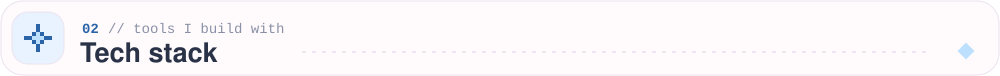
</picture>

<picture>
  <source media="(prefers-color-scheme: dark)" srcset="https://raw.githubusercontent.com/sofiaas16/sofiaas16/main/assets/stack-dark.svg">
  
</picture>

 

<picture>
  <source media="(prefers-color-scheme: dark)" srcset="https://raw.githubusercontent.com/sofiaas16/sofiaas16/main/assets/section-projects-dark.svg">
  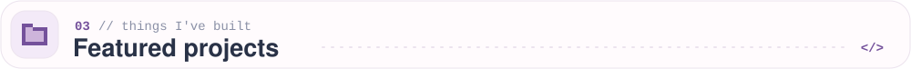
</picture>

<a href="https://github.com/sofiaas16/PHP-Project">
<picture>
  <source media="(prefers-color-scheme: dark)" srcset="https://raw.githubusercontent.com/sofiaas16/sofiaas16/main/assets/project-coffee-dark.svg">
  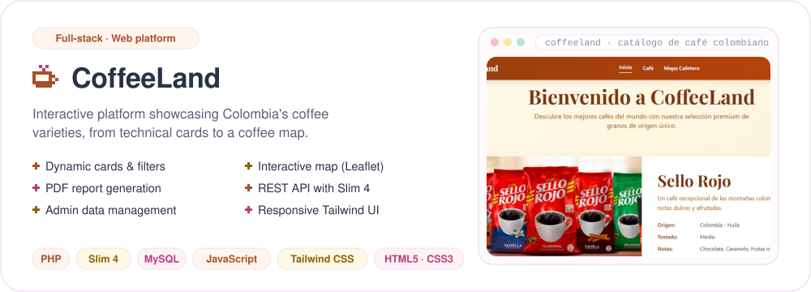
</picture>
</a>

☕ <b>CoffeeLand</b> &nbsp;·&nbsp; <a href="https://github.com/sofiaas16/PHP-Project"><b>View the code ↗</b></a>

<a href="https://github.com/JuanDavid888/F1-Simulador">
<picture>
  <source media="(prefers-color-scheme: dark)" srcset="https://raw.githubusercontent.com/sofiaas16/sofiaas16/main/assets/project-f1-dark.svg">
  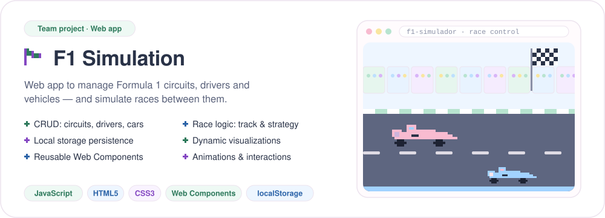
</picture>
</a>

🏎️ <b>F1 Simulation</b> &nbsp;·&nbsp; <a href="https://github.com/JuanDavid888/F1-Simulador"><b>View the code ↗</b></a> (team repository)

 

<picture>
  <source media="(prefers-color-scheme: dark)" srcset="https://raw.githubusercontent.com/sofiaas16/sofiaas16/main/assets/section-activity-dark.svg">
  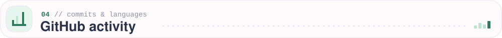
</picture>

  <picture>
    <source media="(prefers-color-scheme: dark)" srcset="https://raw.githubusercontent.com/sofiaas16/sofiaas16/main/profile/stats-dark.svg">
    
  </picture>
  <picture>
    <source media="(prefers-color-scheme: dark)" srcset="https://raw.githubusercontent.com/sofiaas16/sofiaas16/main/profile/top-langs-dark.svg">
    
  </picture>

 

<picture>
  <source media="(prefers-color-scheme: dark)" srcset="https://raw.githubusercontent.com/sofiaas16/sofiaas16/main/assets/section-game-dark.svg">
  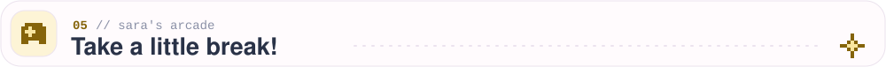
</picture>

<a href="https://sofiaas16.github.io/culebrita/">
<picture>
  <source media="(prefers-color-scheme: dark)" srcset="https://raw.githubusercontent.com/sofiaas16/sofiaas16/main/assets/game-preview-dark.svg">
  
</picture>
</a>

<a href="https://sofiaas16.github.io/culebrita/"><b>🎮 Play Pastel Snake ↗</b></a> &nbsp;·&nbsp; opens in your browser · keyboard or touch

 

<picture>
  <source media="(prefers-color-scheme: dark)" srcset="https://raw.githubusercontent.com/sofiaas16/sofiaas16/main/assets/section-connect-dark.svg">
  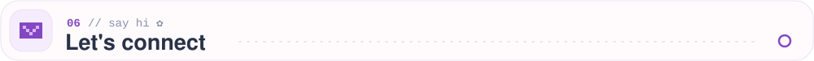
</picture>

  <a href="https://sofiaas16.github.io/Portfolio/"><picture><source media="(prefers-color-scheme: dark)" srcset="https://raw.githubusercontent.com/sofiaas16/sofiaas16/main/assets/contact-portfolio-dark.svg"></picture></a>
  <a href="https://github.com/sofiaas16"><picture><source media="(prefers-color-scheme: dark)" srcset="https://raw.githubusercontent.com/sofiaas16/sofiaas16/main/assets/contact-github-dark.svg"></picture></a>

 

<picture>
  <source media="(prefers-color-scheme: dark)" srcset="https://raw.githubusercontent.com/sofiaas16/sofiaas16/main/assets/footer-dark.svg">
  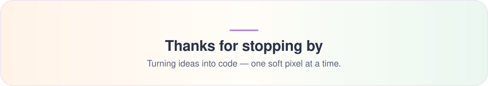
</picture>

  

